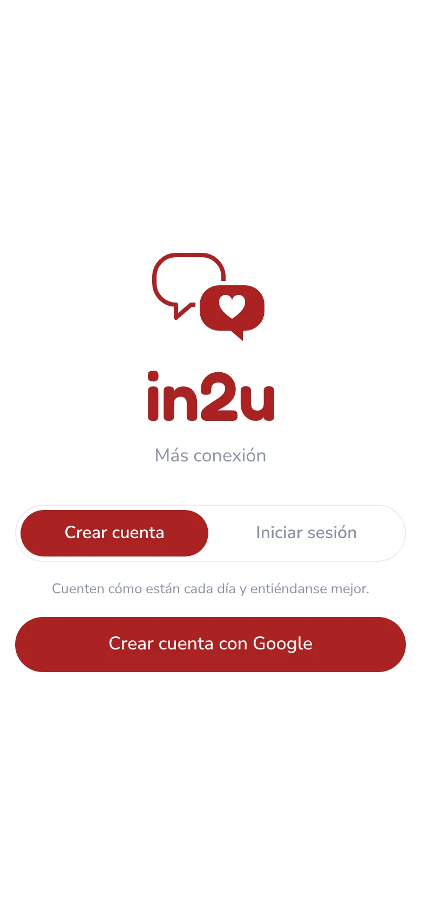
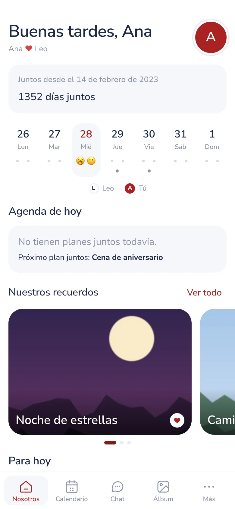
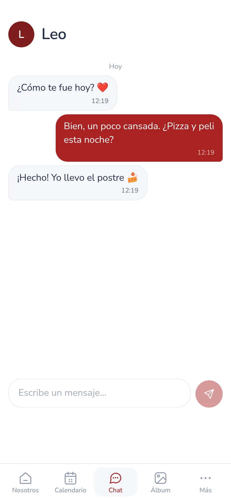
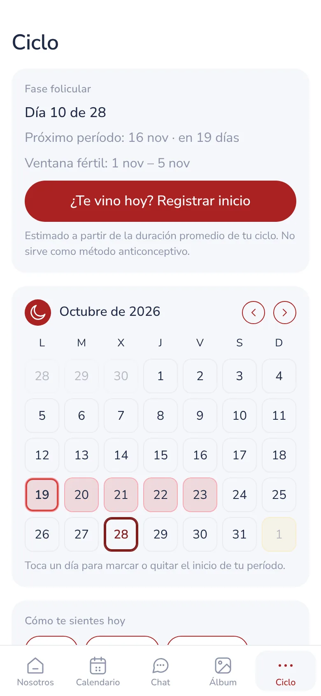
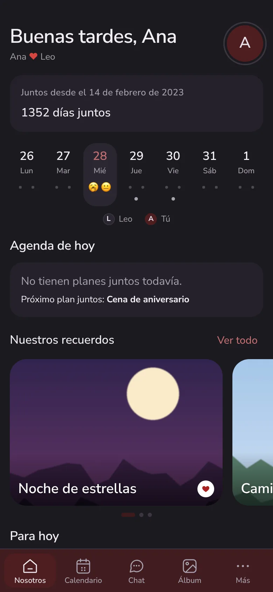
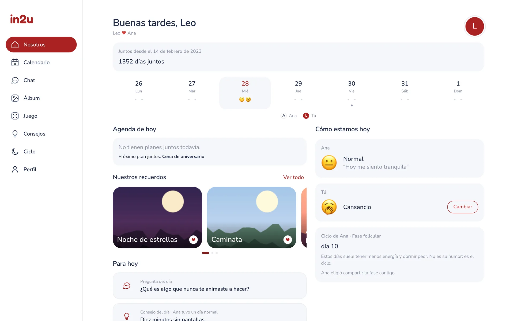
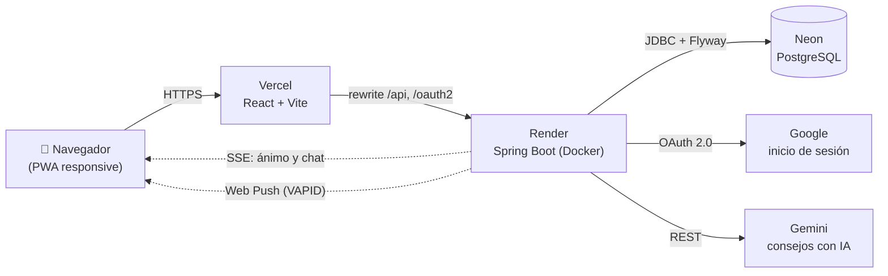

<div align="center">


# in2u

**Más conexión.** Una web app para parejas que quieren comunicarse mejor.

[](https://github.com/melware-labs/in2u/actions/workflows/ci.yml)
[](LICENSE)


[**Abrir la app →**](https://in2u.vercel.app) · [Arquitectura](docs/arquitectura.md) · [Desarrollo](docs/desarrollo.md) · [Publicación](docs/publicar.md) · [English](README.en.md)

</div>

<p align="center">
  
  
  
  
  
</p>

---

## El problema

Muchas parejas no hablan de cómo se sienten hasta que el cansancio o el malestar
ya se convirtieron en una discusión. **in2u** hace que contarlo sea fácil y
cotidiano: cada persona marca cómo está, la otra lo ve al instante y recibe un
consejo concreto para acompañarla. Todo lo demás (calendario, chat, álbum,
juego) gira alrededor de esa idea: menos suposiciones, más conexión.

## Funcionalidades

| | |
|---|---|
| 💬 **Ánimo diario** | Un check-in por día con nota opcional. La pareja lo ve en tiempo real. |
| 💡 **Consejos según el ánimo** | Generados con IA (Gemini) y, si no está disponible, con un motor de reglas propio. |
| 📅 **Calendario compartido** | Eventos «Solo yo» o «Los dos», y el próximo plan juntos en el inicio. |
| 🌙 **Ciclo menstrual** | Fases, próximo período y ventana fértil estimados. Quien lo registra decide qué ve su pareja: nada, solo avisos o fase y avisos. |
| 🗨️ **Chat privado** | Mensajes en tiempo real entre los dos. |
| 🖼️ **Álbum** | Fotos con título y descripción, y el carrusel «Nuestros recuerdos». |
| 🎲 **«¿Cuánto me conoces?»** | Juego de preguntas: respondes sobre ti y adivinas lo que respondió tu pareja. |
| 🔔 **Notificaciones push** | Avisos web (también en iPhone con la app en la pantalla de inicio). |
| ❤️ **Días juntos** | Contador desde el inicio de la relación. |
| 🌐 **Bilingüe y accesible** | Español e inglés, modo día, noche o automático, diseño responsive para celular, tablet y compu. |

<p align="center">
  
</p>

## Arquitectura



- **Un solo dominio.** Vercel reenvía `/api` y las rutas de OAuth al backend, así
  la cookie de sesión es de primera parte y no hace falta CORS.
- **Monolito modular.** El backend está organizado por dominio (`couple`, `mood`,
  `cycle`, `chat`…), cada uno con su controlador, servicio y repositorio.
- **Tiempo real sin infraestructura extra.** Server-Sent Events para el ánimo y
  el chat; sin WebSockets ni brokers.

Más detalle, con el modelo de datos y el flujo de inicio de sesión, en
[docs/arquitectura.md](docs/arquitectura.md).

## Stack

| Capa | Tecnología |
|---|---|
| Frontend | React 19, TypeScript, Vite, Vitest, CSS propio con temas día/noche, Service Worker |
| Backend | Java 21, Spring Boot 4 (Web MVC, Security, OAuth2 Client, Data JPA, Validation, Actuator), Spring Session JDBC |
| Datos | PostgreSQL 16, migraciones versionadas con Flyway |
| Integraciones | Google OAuth 2.0, Google Gemini, Web Push con VAPID |
| Calidad | JUnit, Testcontainers, Vitest, GitHub Actions |
| Infraestructura | Docker multi-stage, Docker Compose, Render, Vercel, Neon |

## Decisiones de ingeniería

- **Privacidad por diseño.** A Gemini solo se envía el número del ánimo; las
  notas personales no salen del servidor salvo que se active `GEMINI_SEND_NOTES`.
  En el ciclo, cada dato que ve la pareja pasa por la visibilidad que eligió
  quien lo registra, y eso se decide en el backend, no en la interfaz.
- **Siempre hay un consejo.** Si Gemini falla, no hay clave o se agota la cuota
  gratuita, un motor de reglas (`RuleBasedTipper`) elige entre un catálogo propio.
  La app nunca depende de un servicio externo para funcionar.
- **Seguridad.** Sesiones en Postgres (sobreviven a reinicios y duran 90 días),
  cookies `Secure` y `SameSite=Lax`, protección CSRF para SPA, límite de intentos
  al vincular con código y un backend que corre en Docker con un usuario sin privilegios.
- **Esquema bajo control.** Hibernate solo valida (`ddl-auto: validate`); cada
  cambio de la base es una migración Flyway revisable.
- **Tests contra una base real.** Los tests de integración levantan PostgreSQL
  con Testcontainers en lugar de usar una base en memoria.
- **Pensada para el plan gratuito.** El backend de Render se duerme; la web lo
  detecta, muestra «Despertando el servidor» y reintenta sin perder la sesión.
- **Mismo backend en local y en producción.** Render construye el mismo
  `backend/Dockerfile` que usa `docker compose` en tu computadora.

## Pruébala en tu computadora

Solo necesitas [Docker](https://www.docker.com/).

```bash
git clone https://github.com/melware-labs/in2u.git
cd in2u
DEV_LOGIN=true docker compose up --build
```

Abre **http://localhost:8080**. Con `DEV_LOGIN=true` puedes entrar sin Google
con cualquier email; abre dos navegadores para probarla como pareja.

Para programar con recarga en caliente, correr los tests o configurar Google y
Gemini, lee [docs/desarrollo.md](docs/desarrollo.md).

## Tests

```bash
cd web && npm test                                   # Vitest
cd backend && TESTCONTAINERS_RYUK_DISABLED=true mvn test   # JUnit + Testcontainers (necesita Docker)
```

GitHub Actions corre los tests de la web y del backend, el build de producción y
el build de las imágenes Docker en cada pull request.

## Estructura del repositorio

```
in2u/
├── web/                  Frontend React + TypeScript (Vercel)
│   ├── src/screens/      Una pantalla por sección
│   ├── src/i18n.ts       Textos en español e inglés
│   └── public/           Logo, íconos PWA, Service Worker y privacidad.html
├── backend/              API Spring Boot (Render)
│   ├── src/main/java/app/in2u/<dominio>/
│   └── src/main/resources/db/migration/   Migraciones Flyway
├── docs/                 Arquitectura, desarrollo, publicación, diseño y capturas
├── .github/workflows/    Integración continua
├── docker-compose.yml    Entorno local completo (db + backend + web)
└── render.yaml           Blueprint del backend en Render
```

## Documentación

- [Arquitectura](docs/arquitectura.md): componentes, modelo de datos, inicio de sesión y tiempo real.
- [Desarrollo](docs/desarrollo.md): correr en local, tests, API y variables de entorno.
- [Publicación](docs/publicar.md): cómo está publicada en Neon, Render y Vercel.
- [Diseño](docs/diseno.md): marca, colores, tipografía y estilo.

## Privacidad

La política de privacidad está en
[in2u.vercel.app/privacidad.html](https://in2u.vercel.app/privacidad.html).
El seguimiento del ciclo es una estimación y no sirve como método anticonceptivo.

## Autora

Diseñada y desarrollada por **Melany**, de [Melware Labs](https://github.com/melware-labs).
Contacto: [melwarelabs@gmail.com](mailto:melwarelabs@gmail.com).

Publicada bajo la [licencia MIT](LICENSE).
