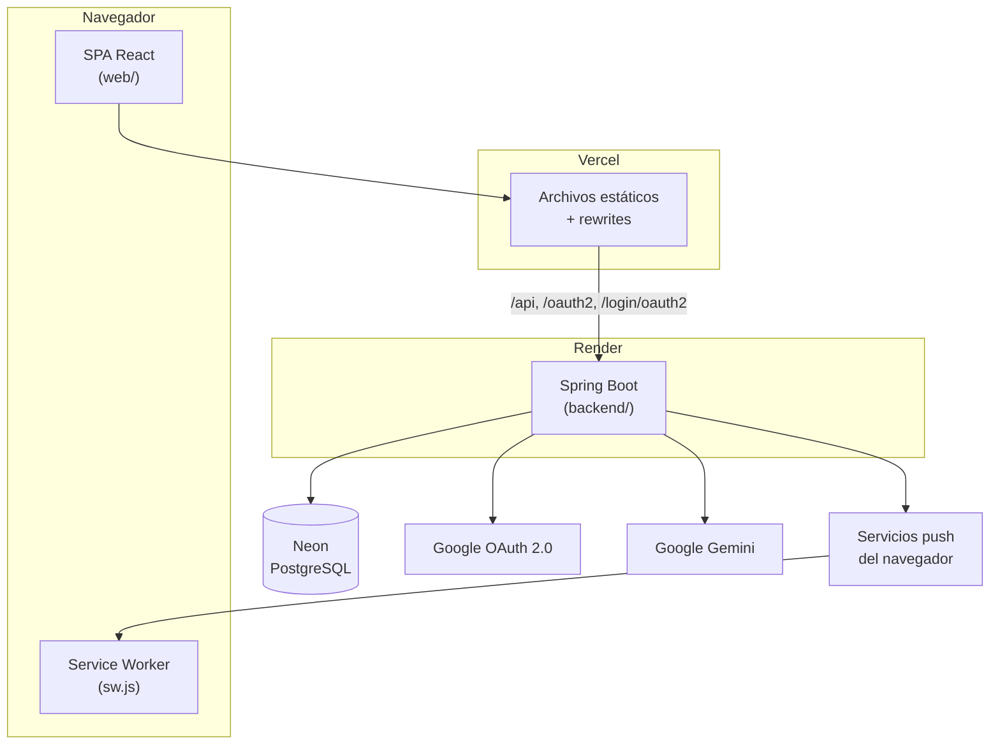
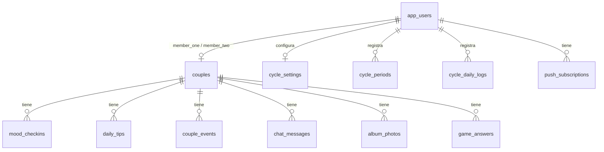
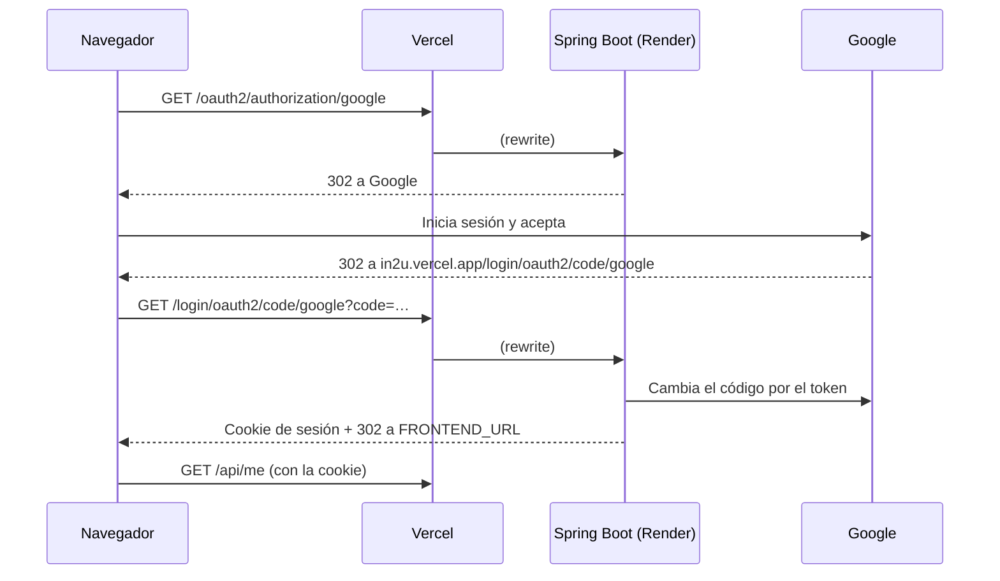
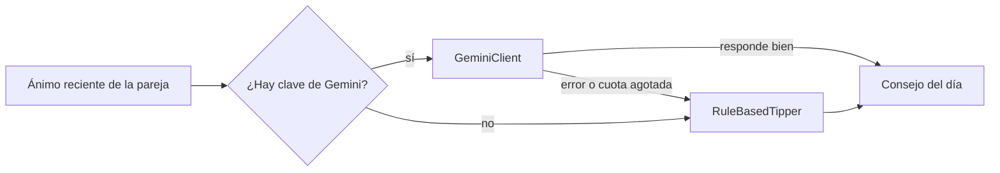

# Arquitectura

in2u es una aplicación web de una sola página (SPA) con una API REST detrás.
La web y la API se publican por separado, pero el navegador las ve bajo un
mismo dominio.

## Componentes



| Pieza | Responsabilidad |
|---|---|
| `web/` | Interfaz, temas día/noche, textos en español e inglés, registro del Service Worker para push. |
| `web/vercel.json` | Reenvía la API y el OAuth a Render y sirve `index.html` para el resto de las rutas. |
| `backend/` | Autenticación, reglas de negocio, permisos de la pareja, tiempo real y notificaciones. |
| PostgreSQL | Datos de la app, sesiones (Spring Session JDBC) y fotos del álbum (`bytea`). |

## Backend: un paquete por dominio

```
app.in2u
├── user      usuario actual (CurrentUser) y perfil
├── couple    vincular con código, días juntos, límite de intentos
├── mood      check-in diario y stream SSE (MoodStream)
├── calendar  calendario compartido
├── cycle     ciclo, cálculo de fases y qué ve la pareja
├── tips      consejos: GeminiClient + RuleBasedTipper + TipCatalog
├── album     fotos
├── chat      mensajes
├── game      «¿Cuánto me conoces?»
├── push      suscripciones y envío de Web Push
├── common    manejo de errores de la API
├── security  sesión, OAuth, CSRF y login de desarrollo
└── config    propiedades (In2uProperties) y reloj
```

Cada dominio tiene sus entidades JPA, repositorios Spring Data, servicio (cuando
hay lógica) y controlador REST. Los controladores no se llaman entre sí: comparten
servicios como `CoupleService.requirePaired`, que garantiza que cada consulta
quede limitada a la pareja de quien la hace.

## Modelo de datos



El esquema vive en `backend/src/main/resources/db/migration` (Flyway, `V1`…`V5`).
Hibernate corre con `ddl-auto: validate`: nunca cambia la base por su cuenta.
Todas las claves foráneas usan `on delete cascade`, así borrar a una persona
borra sus datos.

## Inicio de sesión



- La URI de redirección se fija con `OAUTH_REDIRECT_URI`, porque detrás del
  proxy de Vercel Spring vería el host de Render.
- La sesión se guarda en Postgres y dura 90 días.
- Las peticiones que cambian datos llevan el token CSRF de la cookie `XSRF-TOKEN`.

## Tiempo real

- **Ánimo y chat**: `GET /api/mood/stream` abre un Server-Sent Events por persona.
  Cuando la pareja guarda su ánimo o manda un mensaje, el backend emite un evento
  (`mood` o `chat`) y la web recarga solo esa parte.
- **Notificaciones push**: con la app cerrada, el backend envía Web Push firmado
  con claves VAPID; `web/public/sw.js` muestra la notificación.

## Consejos



El consejo se guarda en `daily_tips`, así se pide una sola vez por día y persona.
A Gemini solo llegan los números del ánimo; las notas escritas se envían solo si
`GEMINI_SEND_NOTES=true`.

## Despliegue

| Entorno | Web | API | Base de datos |
|---|---|---|---|
| Local | nginx en Docker (`web/Dockerfile`) o `npm run dev` | `backend/Dockerfile` o `mvn spring-boot:run` | Postgres en Docker |
| Producción | Vercel (Root Directory `web`) | Render (`render.yaml`) | Neon |

Cada merge a `main` publica de nuevo la web y el backend. Los detalles están en
[publicar.md](publicar.md).
